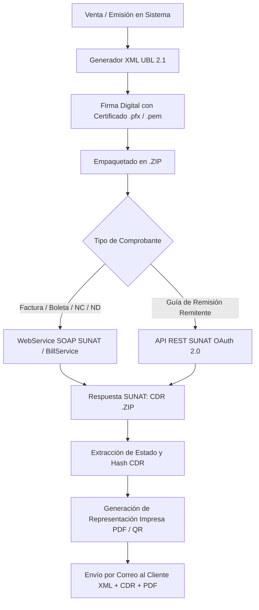

# 🚀 Sistema de Facturación Electrónica SUNAT (Perú) - UBL 2.1


Sistema integral de gestión comercial y **Facturación Electrónica para Perú**, desarrollado bajo el estándar **UBL 2.1** de la **SUNAT**. Permite emitir facturas, boletas, notas de crédito, notas de débito y guías de remisión electrónica (GRE) con firma digital y envío directo a los servidores de SUNAT (SOAP y REST API).

---

## 📑 Tabla de Contenidos

1. [Características Principales](#-características-principales)
2. [Arquitectura y Flujo de Emisión](#-arquitectura-y-flujo-de-emisión)
3. [Módulos del Sistema](#-módulos-del-sistema)
4. [Tecnologías Utilizadas](#-tecnologías-utilizadas)
5. [Requisitos Previos](#-requisitos-previos)
6. [Instalación y Configuración](#-instalación-y-configuración)
7. [Configuración con SUNAT](#-configuración-con-sunat)
8. [Estructura del Proyecto](#-estructura-del-proyecto)
9. [Credenciales por Defecto](#-credenciales-por-defecto)
10. [Licencia](#-licencia)

---

## ✨ Características Principales

- 🧾 **Facturación Electrónica SUNAT UBL 2.1**: Emisión directa sin intermediarios OSE requeridos.
- 🔐 **Firma Digital XML**: Firma de comprobantes con certificados digitales X.509 (`.pfx` y `.pem`) mediante algoritmo `SHA-256 with RSA Encryption`.
- 📦 **Empaquetado y Envío Automático**: Compresión en ZIP, comunicación vía Web Services SOAP de SUNAT y almacenamiento automático del CDR (Constancia de Recepción).
- 🚚 **Guías de Remisión Electrónica (GRE)**: Integración con la nueva API REST de SUNAT mediante autenticación OAuth 2.0 (Bearer Token).
- 🖨️ **Formatos de Impresión**:
  - Formato Ticket POS (80mm y 58mm).
  - Formato A4 profesional con código QR y código de barras PDF417.
- 📧 **Notificación por Correo**: Envío automático al cliente de PDF, XML firmado y CDR mediante PHPMailer / SMTP.
- 📊 **Gestión Comercial Completa**: Compras, ventas, cotizaciones, inventario, clientes, proveedores y reportes.

---

## 🔄 Arquitectura y Flujo de Emisión



---

## 📦 Módulos del Sistema

### 1. Panel de Control (Dashboard)
- Indicadores en tiempo real: ventas del día, compras, total de clientes y productos.
- Gráficos estadísticos de ventas mensuales y anuales (Morris.js).
- Ranking interactivo de los productos más vendidos.

### 2. Comprobantes de Pago Electrónicos
- **Facturas Electrónicas (01)**: Clientes con RUC, operaciones gravadas, exoneradas, inafectas, IGV 18%, soporte de ventas al contado o al crédito (con cuotas).
- **Boletas de Venta Electrónicas (03)**: Clientes con DNI o Venta Menor (Consumidor Final).
- **Notas de Crédito (07)**: Anulación de la operación, anulación por error en el RUC, corrección por error en la descripción, descuento global, etc.
- **Notas de Débito (08)**: Intereses por mora, aumento en el valor, penalidades.
- **Resumen Diario y Comunicación de Bajas**: Generación de paquetes de boletas y solicitud de anulación de comprobantes emitidos.
- **Consulta de Comprobantes**: Verificación de estado, descarga individual de XML, CDR y PDF.

### 3. Guías de Remisión Electrónica (GRE - 09)
- GRE Remitente bajo la normativa vigente de SUNAT.
- Modalidad de transporte: Transporte Privado y Transporte Público.
- Conexión vía API REST SUNAT con credenciales `client_id` y `secret_id`.

### 4. Cotizaciones / Proformas
- Generación y envío de cotizaciones comerciales.
- Opción de facturación directa: convierte una cotización aprobada en Factura o Boleta con un solo clic.

### 5. Compras y Proveedores
- Registro detallado de compras con comprobante de proveedor.
- Cálculo de costos, afectación tributaria y control de pagos.
- Directorio de proveedores y kardex de compras.

### 6. Inventario y Productos
- Gestión de productos físicos y servicios.
- Control de stock, precios de compra y venta.
- Clasificación por categorías y unidades de medida normalizadas (Catálogo 03 SUNAT: NIU, ZZ, KGM, etc.).
- Soporte para lector de código de barras.

### 7. Clientes y Búsqueda RUC / DNI
- Registro de clientes con validación de tipo de documento (DNI, RUC, Pasaporte, C.E.).
- Consulta y autocompletado de datos ante padrón / API de SUNAT y RENIEC.

### 8. Reportes y Exportación
- Reporte detallado de ventas por fechas, vendedor o cliente.
- Reporte de compras por proveedor y período.
- Reporte de créditos y control de cuotas pendientes.
- Exportación directa a hojas de cálculo en Excel.

### 9. Configuración de Empresa (Emisor)
- Datos fiscales (RUC, Razón Social, Nombre Comercial, Dirección, Ubigeo).
- Configuración de certificados digitales (`.pfx` / `.pem`) y contraseña.
- Conmutador de entorno: **Modo Pruebas (Beta)** o **Modo Producción**.
- Configuración de credenciales SOL (Usuario y Clave SOL) y API REST.
- Parámetros de correo saliente SMTP para notificaciones.
- Configuración de series y correlativos por tipo de documento.

---

## 🛠️ Tecnologías Utilizadas

- **Backend**: PHP 7.4 / 8.0 / 8.1 (Programación Orientada a Objetos, MVC, PDO).
- **Base de Datos**: MySQL 5.7+ / MariaDB 10.4+.
- **Frontend**:
  - AdminLTE 2.4
  - Bootstrap 3.3.7
  - jQuery 3.x
  - DataTables con exportación (Excel, PDF, impresión)
  - Morris.js para gráficos
  - SweetAlert2 & Toastr para notificaciones interactivas
- **Generación de Documentos**:
  - TCPDF & HTML2PDF (PDFs en A4 y formato Ticket 80mm/58mm)
  - Generación de Códigos QR y Códigos de Barras
- **Librerías y Servicios**:
  - OpenSSL para la firma digital UBL
  - ZipArchive para empaquetado y lectura de CDR
  - SoapClient para el envío SOAP a SUNAT
  - cURL para la API REST de Guías y APIs de consulta
  - PHPMailer para el envío de comprobantes por correo

---

## 📋 Requisitos Previos

Asegúrate de contar con un entorno de desarrollo local como **Laragon**, **XAMPP** o un servidor **Apache / Nginx** en Linux con:

1. **PHP >= 7.4** (Recomendado: PHP 8.1)
2. **Extensiones PHP activadas en `php.ini`**:
   ```ini
   extension=pdo_mysql
   extension=openssl
   extension=soap
   extension=curl
   extension=zip
   extension=mbstring
   extension=gd
   extension=fileinfo
   ```
3. **Módulo `mod_rewrite` habilitado** en Apache (para el enrutamiento con `.htaccess`).
4. **Composer** instalado globalmente.

---

## 🚀 Instalación y Configuración

### 1. Clonar el repositorio
Ubica el proyecto dentro del directorio raíz de tu servidor web (por ejemplo, `c:\laragon\www\` o `c:\xampp\htdocs\`):
```bash
git clone https://github.com/EliLuxurious/facturaci-n.git facturacion
cd facturacion
```

### 2. Instalar dependencias con Composer
```bash
composer install
```

### 3. Crear la base de datos
1. Abre tu gestor de base de datos preferido (phpMyAdmin, HeidiSQL, DBeaver o MySQL CLI).
2. Crea una nueva base de datos llamada `dbfacturacion`:
   ```sql
   CREATE DATABASE dbfacturacion CHARACTER SET utf8 COLLATE utf8_spanish_ci;
   ```
3. Importa el archivo SQL incluido en la carpeta `BD`:
   - Archivo: `BD/bdsistema.sql`

### 4. Configurar la conexión a la base de datos
Edita el archivo `Conect/Conexion.php` con las credenciales de tu servidor MySQL:

```php
// Conect/Conexion.php
class Conexion {
    const HOST = 'localhost';
    const USER = 'root';
    const PASSWORD = '';
    const BDNAME = 'dbfacturacion';
    
    // ...
}
```

### 5. Permisos de carpetas (Entornos Linux / Producción)
Asegúrate de otorgar permisos de escritura a las carpetas donde se guardan XML, CDRs y certificados:
```bash
chmod -R 775 api/xml api/cdr api/certificado vistas/img
```

---

## 🏛️ Configuración con SUNAT

Para emitir comprobantes, ingresa al menú **Configuración > Empresa**:

### Entorno de Pruebas (Beta SUNAT):
1. **Modo**: Seleccionar `Pruebas (Beta)`.
2. **RUC**: Tu número de RUC de prueba o el RUC de la empresa.
3. **Usuario Secundario**: `MODDATOS`
4. **Clave SOL**: `MODDATOS`
5. **Certificado Digital**: Cargar el certificado de prueba proporcionado en `api/certificado/certificado_prueba.pfx` (Clave: `ceti`).

### Entorno de Producción:
1. **Modo**: Seleccionar `Producción`.
2. **Usuario SOL**: Usuario secundario creado en el portal de SUNAT con permisos de facturación electrónica.
3. **Clave SOL**: Contraseña del usuario secundario.
4. **Certificado Digital**: Carga tu archivo `.pfx` emitido por una entidad certificadora autorizada y digita la contraseña correspondiente.
5. **API Guías de Remisión (Opcional para GRE)**:
   - Registrar la aplicación en el portal de SUNAT para obtener el `Client ID` y `Client Secret`.

---

## 📂 Estructura del Proyecto

```text
facturacion/
├── ajax/                 # Peticiones asíncronas AJAX por cada módulo
├── api/                  # Núcleo de facturación electrónica UBL 2.1
│   ├── ApiFacturacion.php# Lógica de envío SOAP y REST a SUNAT
│   ├── GeneradorXML.php  # Construcción del XML UBL 2.1
│   ├── Signature.php     # Firma digital con certificado X.509 (SHA-256)
│   ├── cdr/              # Archivos CDR recibidos de SUNAT
│   ├── certificado/      # Certificados digitales (.pfx / .pem)
│   └── xml/              # Archivos XML generados y firmados
├── BD/
│   └── bdsistema.sql     # Script SQL con estructura y datos iniciales
├── Conect/
│   └── Conexion.php      # Conexión PDO a la base de datos
├── Controladores/        # Controladores MVC de la aplicación
├── Modelos/              # Modelos de acceso a datos y consultas PDO
├── pdf/                  # Motor de generación de reportes y PDFs (TCPDF/HTML2PDF)
├── vistas/               # Vistas, componentes y diseño
│   ├── css/              # Hojas de estilo personalizadas
│   ├── js/               # Scripts frontend y control de formularios
│   ├── modulos/          # Páginas y vistas del sistema
│   ├── pack/             # Recursos de terceros (AdminLTE, Bootstrap, Plugins)
│   ├── print/            # Plantillas de impresión (Ticket, A4, Envíos por correo)
│   └── plantilla.php     # Layout principal del sistema
├── .htaccess             # Reglas de reescritura de URLs amigables
├── composer.json         # Autoload PSR-4 y dependencias del proyecto
└── index.php             # Punto de entrada de la aplicación
```

---

## 🔑 Credenciales por Defecto

Al importar la base de datos inicial (`BD/bdsistema.sql`), se incluye el siguiente acceso administrativo:

| Campo | Valor |
| :--- | :--- |
| **URL de Acceso** | `http://localhost/facturacion/` |
| **Usuario** | `demo` |
| **Perfil** | `Administrador` |

> [!TIP]
> Recuerda cambiar las credenciales y actualizar los datos de la empresa emisor al desplegar el sistema en un entorno de producción.

---

## 📄 Licencia

Este proyecto se distribuye bajo la licencia **MIT**. Eres libre de usarlo, modificarlo y adaptarlo a tus necesidades comerciales o educativas.

---

<p align="center">
  Desarrollado con ❤️ para impulsar la digitalización y cumplimiento tributario en el Perú 🇵🇪.
</p>
